  <picture>
    <source media="(prefers-color-scheme: dark)" srcset="assets/banner-dark.svg">
    
  </picture>

  <a href="https://johnnychen.dev"><picture><source media="(prefers-color-scheme: dark)" srcset="assets/buttons/portfolio-dark.svg"></picture></a>
  <a href="https://www.linkedin.com/in/johnnychen7"><picture><source media="(prefers-color-scheme: dark)" srcset="assets/buttons/linkedin-dark.svg"></picture></a>
  <a href="mailto:jchen449@outlook.com"><picture><source media="(prefers-color-scheme: dark)" srcset="assets/buttons/email-dark.svg"></picture></a>

**Computer Science at the University at Buffalo, class of 2028.** I build accessible iOS software and do LLM/AI research. Looking for **Summer 2027 software engineering and AI/ML internships**.

- **Software Engineering Fellow, UB Forge:** selected as 1 of 14 fellows from 250+ applicants
- **LLM/AI Researcher, Algoverse:** configured and validated a GPU-accelerated research environment
- **Data Analyst Intern, Sea Tow Foundation:** streamlined data workflows tracking 10,000+ units

  <picture><source media="(prefers-color-scheme: dark)" srcset="assets/icons/python-dark.svg"></picture>
  <picture><source media="(prefers-color-scheme: dark)" srcset="assets/icons/java-dark.svg"></picture>
  
  
  
  
  <picture><source media="(prefers-color-scheme: dark)" srcset="assets/icons/react-dark.svg"></picture>
  <picture><source media="(prefers-color-scheme: dark)" srcset="assets/icons/pytorch-dark.svg"></picture>
  <picture><source media="(prefers-color-scheme: dark)" srcset="assets/icons/postgresql-dark.svg"></picture>
  
  <picture><source media="(prefers-color-scheme: dark)" srcset="assets/icons/aws-dark.svg"></picture>
  
  <picture><source media="(prefers-color-scheme: dark)" srcset="assets/icons/linux-dark.svg"></picture>
   Python, Java, C/C++, JavaScript, Swift, SQL, React, PyTorch, CUDA, PostgreSQL, Docker, AWS, Git, Linux

Project deep dives live in my pinned repositories, starting with [Anchor](https://github.com/Not-Depth/Anchor): accessible campus navigation for iPhone with step-free routing, LiDAR proximity alerts and 40 unit tests.
