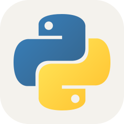
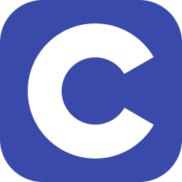
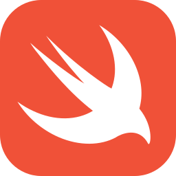
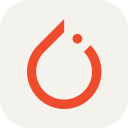
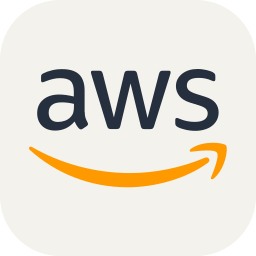

<picture>
  <source media="(max-width: 600px)" srcset="assets/sign-narrow.svg">
  
</picture>

I build accessible iOS software and do LLM/AI research. Graduating in May 2028 and looking for **Summer 2027 software engineering and AI/ML internships**.

- **Software Engineering Fellow, UB Forge:** selected as 1 of 14 fellows from 250+ applicants
- **LLM/AI Researcher, Algoverse:** configured and validated a GPU-accelerated research environment
- **Data Analyst Intern, Sea Tow Foundation:** streamlined data workflows tracking 10,000+ units

  <picture><source media="(prefers-color-scheme: dark)" srcset="assets/icons/python-dark.svg"></picture>
  <picture><source media="(prefers-color-scheme: dark)" srcset="assets/icons/java-dark.svg"></picture>
  
  
  
  
  <picture><source media="(prefers-color-scheme: dark)" srcset="assets/icons/react-dark.svg"></picture>
  <picture><source media="(prefers-color-scheme: dark)" srcset="assets/icons/pytorch-dark.svg"></picture>
  <picture><source media="(prefers-color-scheme: dark)" srcset="assets/icons/postgresql-dark.svg"></picture>
  
  <picture><source media="(prefers-color-scheme: dark)" srcset="assets/icons/aws-dark.svg"></picture>
  
  <picture><source media="(prefers-color-scheme: dark)" srcset="assets/icons/linux-dark.svg"></picture>

My pinned repositories have the details, starting with [Anchor](https://github.com/Not-Depth/Anchor): accessible campus navigation for iPhone with step-free routing, LiDAR proximity alerts and 40 unit tests.
