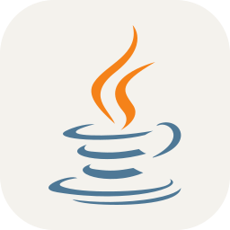

  <picture>
    <source media="(max-width: 600px)" srcset="assets/header-narrow.svg">
    
  </picture>

  
  
  

🔎 Open to Summer 2027 software engineering and AI/ML internships 🔍

### 🧑‍💻 Current 

- **Software Engineering Fellow** @ UB Forge: building [Anchor](https://github.com/Not-Depth/Anchor), an accessible campus navigation app for iPhone
- **LLM/AI Researcher** @ Algoverse: configured and validated a GPU-accelerated research environment

### ⭐ Highlights

- Selected as **1 of 14** UB Forge fellows from 250+ applicants
- **[Anchor](https://github.com/Not-Depth/Anchor):** step-free routing, LiDAR proximity alerts, 40 unit tests; 43North demo planned for Dec 2026
- **Rubik's Cube CFOP solver:** BFS move search with quaternion-driven Three.js animation, migrated to React
- **Data Analyst Intern** @ Sea Tow Foundation: streamlined data workflows tracking 10,000+ units

### 🛠️ Stack 

  <picture><source media="(prefers-color-scheme: dark)" srcset="assets/icons/python-dark.svg"></picture>
  <picture><source media="(prefers-color-scheme: dark)" srcset="assets/icons/java-dark.svg"></picture>
  
  
  
  
  <picture><source media="(prefers-color-scheme: dark)" srcset="assets/icons/react-dark.svg"></picture>
  <picture><source media="(prefers-color-scheme: dark)" srcset="assets/icons/pytorch-dark.svg"></picture>
  <picture><source media="(prefers-color-scheme: dark)" srcset="assets/icons/postgresql-dark.svg"></picture>
  
  <picture><source media="(prefers-color-scheme: dark)" srcset="assets/icons/aws-dark.svg"></picture>
  
  <picture><source media="(prefers-color-scheme: dark)" srcset="assets/icons/linux-dark.svg"></picture>

